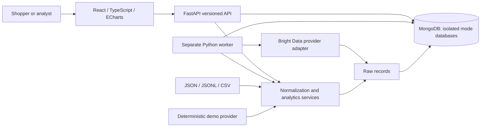
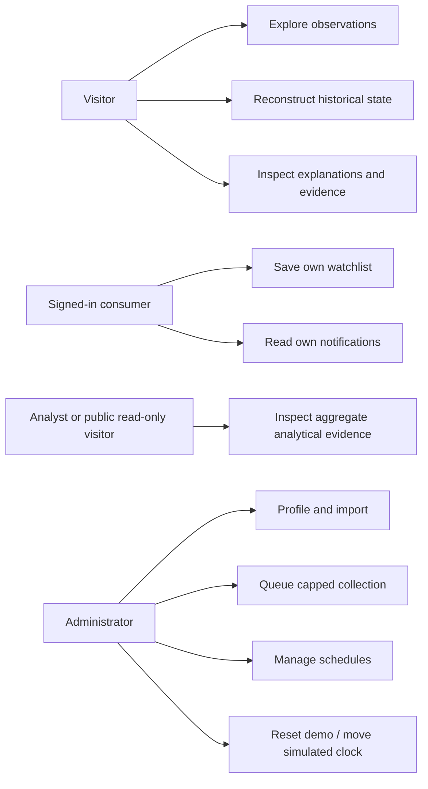
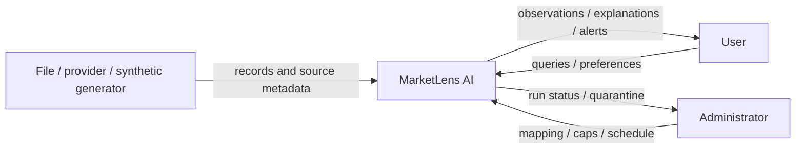
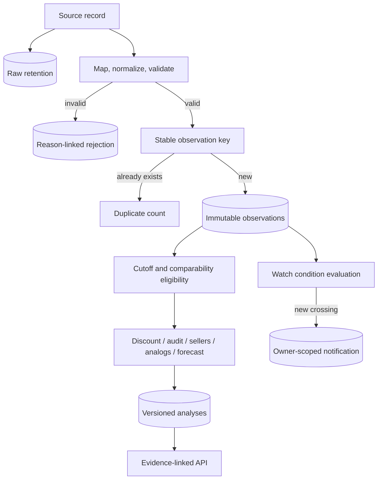
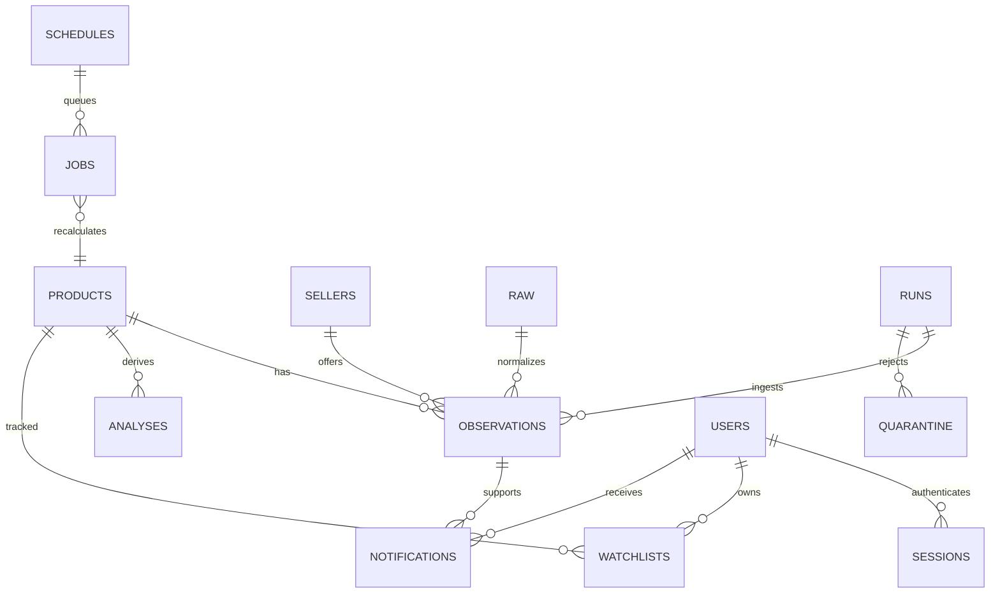
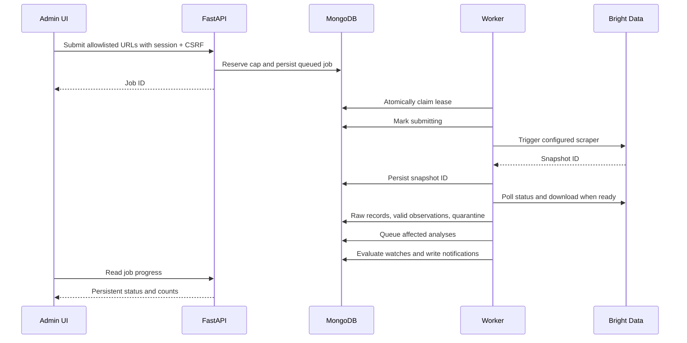
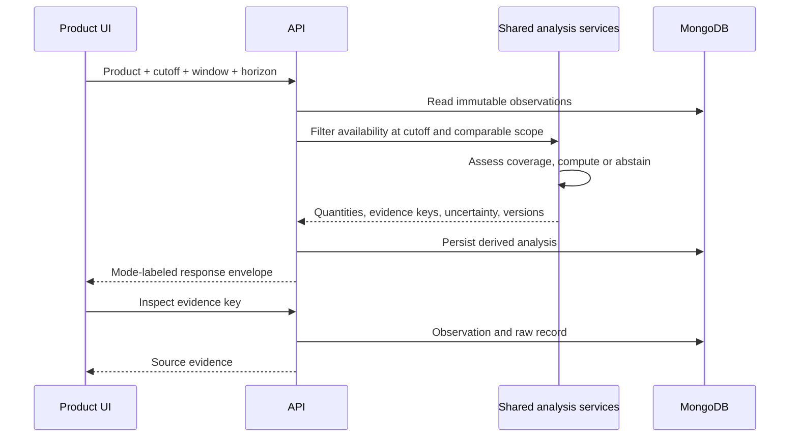

# Editable system diagrams

These Mermaid diagrams describe the implemented system. Render with a Mermaid-compatible Markdown viewer or paste each block into Mermaid Live Editor for SVG export.

## Architecture

## Use cases

## Data-flow diagram: context

## Data-flow diagram: processing

## Entity relationships

Forecasts, event-memory matches, quality results and audit findings are embedded in versioned analysis documents rather than duplicated across separate collections.

## Ingestion sequence

## Analysis sequence

